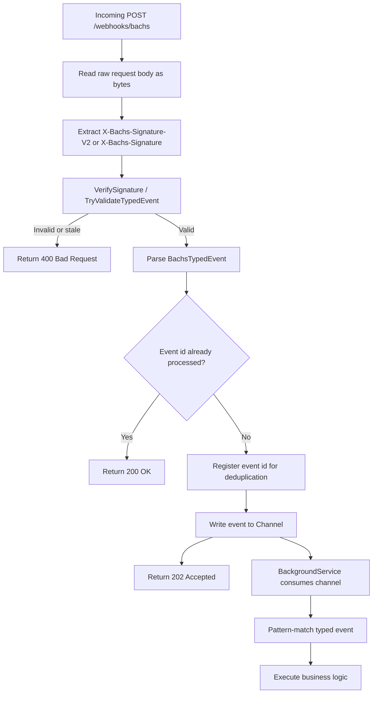

# Webhooks Client & Signature Verification

## Table of Contents

- [Overview](#overview)
- [Methods Overview](#methods-overview)
- [Usage Examples](#usage-examples)
- [Cryptographic Signature Verification](#cryptographic-signature-verification)
- [Validation Entry Points](#validation-entry-points)
- [Secret Resolution](#secret-resolution)
- [Signature Formats](#signature-formats)
- [Minimal API Implementation (payload bytes)](#minimal-api-implementation-payload-bytes)
- [Controller Implementation (payload bytes)](#controller-implementation-payload-bytes)
- [Deduplication by Event Id](#deduplication-by-event-id)
- [Background Processing with Channels](#background-processing-with-channels)
- [Standalone `WebhookEventValidator`](#validating-via-standalone-webhookeventvalidator)
- [Static `BachsWebhook`](#validating-via-static-bachswebhook)
- [Models](#models)

## Overview

The Webhooks client allows programmatic registration and management of webhook destination endpoints, subscribing to specific event topics, performing zero-downtime secret rotations, and inspecting past delivered webhook events.

In addition to the client, the SDK provides the static [`BachsWebhook`](https://github.com/amaechijude/bachs-sdk-net/blob/main/src/Bachs/WebHooks/BachsWebhook.cs) class for cryptographic signature verification.

- **Interface**: [`IWebhooksClient`](https://github.com/amaechijude/bachs-sdk-net/blob/main/src/Bachs/Clients/IWebhooksClient.cs) (implements [`IWebhookEventValidator`](https://github.com/amaechijude/bachs-sdk-net/blob/main/src/Bachs/WebHooks/IWebhookEventValidator.cs) and its alias `IWebhookValidator`)
- **Implementation**: [`WebhooksClient`](https://github.com/amaechijude/bachs-sdk-net/blob/main/src/Bachs/Clients/WebhooksClient.cs)
- **Property**: `client.Webhooks`
- **Standalone validator**: [`WebhookEventValidator`](https://github.com/amaechijude/bachs-sdk-net/blob/main/src/Bachs/WebHooks/WebhookEventValidator.cs) — the same validation surface without an API client, backed by a configured default secret.
- **DI Service**: `services.AddBachsClient(...)` registers `IWebhooksClient`, `IWebhookEventValidator`, and `IWebhookValidator` as transient services (the latter two resolve to the webhooks client).

> **Handling responses:** Every client method returns `BachsResponse<T>` and returns (rather than throws) on API errors (4xx/5xx). Always check `response.IsSuccessStatusCode` first: on **failure**, inspect `response.Error`/`response.StatusCode` and handle it (log it, retry, or surface it to the caller); on **success**, read the parsed payload from `response.Data`. Transport, timeout, circuit-breaker, and serialization failures still throw typed `Bachs.Exceptions` — see [Response Handling](../README.md#response-handling).

---

## Methods Overview

| Method | HTTP | Path | Description |
|---|---|---|---|
| [`ValidateTypedEvent`](#cryptographic-signature-verification) | - | Local | Validates signature, verifies timestamp tolerance, and parses into a strongly-typed `BachsTypedEvent`. |
| [`TryValidateTypedEvent`](#cryptographic-signature-verification) | - | Local | Safely validates and parses into a `BachsTypedEvent` without throwing exceptions. |
| [`ValidateEvent`](#cryptographic-signature-verification) | - | Local | Validates signature, verifies timestamp tolerance, and parses incoming raw webhook event. |
| [`TryValidateEvent`](#cryptographic-signature-verification) | - | Local | Safely validates an incoming raw webhook delivery without throwing exceptions. |
| [`VerifySignature`](#cryptographic-signature-verification) | - | Local | Cryptographically verifies the webhook signature header against payload. |
| [`CreateEndpointAsync`](#1-create-a-webhook-endpoint) | `POST` | `/v1/webhooks/endpoints` | Registers a new HTTPS destination endpoint and generates a signing secret. |
| [`GetEndpointAsync`](#2-retrieve-an-endpoint) | `GET` | `/v1/webhooks/endpoints/{endpointId}` | Retrieves endpoint details and subscribed topics. |
| [`ListEndpointsAsync`](#3-list-endpoints) | `GET` | `/v1/webhooks/endpoints` | Lists all configured webhook destinations. |
| [`UpdateEndpointAsync`](#4-update-an-endpoint) | `PATCH` | `/v1/webhooks/endpoints/{endpointId}` | Updates destination URL or subscribed event list. |
| [`DeleteEndpointAsync`](#5-delete-an-endpoint) | `DELETE` | `/v1/webhooks/endpoints/{endpointId}` | Deletes a webhook destination. |
| [`RotateSecretAsync`](#6-rotate-signing-secret) | `POST` | `/v1/webhooks/endpoints/{endpointId}/rotate-secret` | Rotates the HMAC signing secret with zero downtime. |
| [`ListEventsAsync`](#7-list-webhook-events) | `GET` | `/v1/webhooks/events` | Retrieves history of fired events and payloads. |
| [`GetEventAsync`](#8-retrieve-an-event) | `GET` | `/v1/webhooks/events/{eventId}` | Retrieves a single webhook event record by ID. |

---

## Usage Examples

### 1. Create a Webhook Endpoint

Register your server's endpoint to listen for specific notifications:

```csharp
using Bachs.Clients;
using Bachs.Models.Webhooks;

var response = await client.Webhooks.CreateEndpointAsync(new CreateWebhookEndpointRequest
{
    Url = "https://api.myplatform.com/webhooks/bachs",
    Events = new List<string>
    {
        "collection.succeeded",
        "checkout.completed",
        "customer.subscription.created",
        "customer.subscription.updated",
        "refund.succeeded"
    }
});
if (!response.IsSuccessStatusCode)
{
    // Handle the error: log it and take the appropriate action (return, retry, or surface it).
    // e.g. logger.LogError("Webhook endpoint creation failed ({StatusCode}): {Detail}", (int)response.StatusCode, response.Error?.Detail);
    return;
}

var endpoint = response.Data;

Console.WriteLine($"Endpoint ID: {endpoint.Id}");
Console.WriteLine($"Webhook Secret (save securely): {endpoint.Secret}");
```

---

### 2. Retrieve & Update an Endpoint

```csharp
// Retrieve
var getResponse = await client.Webhooks.GetEndpointAsync("we_100200300");
if (!getResponse.IsSuccessStatusCode)
{
    // Handle the error: log it and take the appropriate action (return, retry, or surface it).
    // e.g. logger.LogError("Webhook endpoint lookup failed ({StatusCode}): {Detail}", (int)getResponse.StatusCode, getResponse.Error?.Detail);
    return;
}

var ep = getResponse.Data;
Console.WriteLine($"URL: {ep.Url} ({string.Join(", ", ep.Events)})");

// Update URL or events
var updateResponse = await client.Webhooks.UpdateEndpointAsync("we_100200300", new UpdateWebhookEndpointRequest
{
    Url = "https://api.myplatform.com/v2/webhooks/bachs",
    Events = new List<string> { "collection.succeeded", "checkout.completed" }
});
if (!updateResponse.IsSuccessStatusCode)
{
    // Handle the error: log it and take the appropriate action (return, retry, or surface it).
    // e.g. logger.LogError("Webhook endpoint update failed ({StatusCode}): {Detail}", (int)updateResponse.StatusCode, updateResponse.Error?.Detail);
    return;
}

var updated = updateResponse.Data;
```

---

### 3. Rotate Webhook Signing Secret

Generate a new secret while keeping the previous secret valid temporarily during the grace window:

```csharp
var response = await client.Webhooks.RotateSecretAsync("we_100200300");
if (!response.IsSuccessStatusCode)
{
    // Handle the error: log it and take the appropriate action (return, retry, or surface it).
    // e.g. logger.LogError("Webhook secret rotation failed ({StatusCode}): {Detail}", (int)response.StatusCode, response.Error?.Detail);
    return;
}

var rotation = response.Data;

Console.WriteLine($"New Signing Secret: {rotation.Secret}");
// Deploy the new secret to your application configuration
```

---

### 4. Delete an Endpoint

```csharp
var response = await client.Webhooks.DeleteEndpointAsync("we_100200300");
if (!response.IsSuccessStatusCode)
{
    // Handle the error: log it and take the appropriate action (return, retry, or surface it).
    // e.g. logger.LogError("Webhook endpoint deletion failed ({StatusCode}): {Detail}", (int)response.StatusCode, response.Error?.Detail);
    return;
}

Console.WriteLine("Webhook endpoint unregistered.");
```

---

### 5. Inspect Event History

```csharp
var response = await client.Webhooks.ListEventsAsync();
if (!response.IsSuccessStatusCode)
{
    // Handle the error: log it and take the appropriate action (return, retry, or surface it).
    // e.g. logger.LogError("Webhook event list request failed ({StatusCode}): {Detail}", (int)response.StatusCode, response.Error?.Detail);
    return;
}

var events = response.Data;

foreach (var evt in events.Items)
{
    Console.WriteLine($"Event {evt.Id}: {evt.Type} at {evt.CreatedAt}");
}
```

---

## Cryptographic Signature Verification

Every validation method shares the same parameter shape (instance APIs make `secret` optional; the static `BachsWebhook` requires it):

```csharp
// String payload:
ValidateEvent(payload, signatureHeader, secret = null, toleranceSeconds = 300, timestampHeader = null)
// Raw bytes (preferred, avoids re-encoding the body):
ValidateEvent(payloadBytes, signatureHeader, secret = null, toleranceSeconds = 300, timestampHeader = null)
```

- `signatureHeader` comes from `X-Bachs-Signature-V2` (preferred) or `X-Bachs-Signature` (legacy V1).
- `timestampHeader` is only needed for V1 signatures, where the Unix timestamp travels in `X-Bachs-Timestamp`. V2 headers (`t=<unix>,v1=<hex>`) carry their own timestamp, so it can be left `null`.
- `toleranceSeconds` is the anti-replay window; it defaults to `BachsWebhook.DefaultToleranceSeconds` (300 seconds / 5 minutes). Deliveries outside the window fail validation.
- **Prefer the `byte[] payloadBytes` overloads.** They take the raw request body as-is and guarantee the signed bytes are never re-encoded or re-serialized.

### Validation Entry Points

You can validate incoming webhook deliveries in three ways:

| Entry point | When to use |
|---|---|
| [`IWebhooksClient` / `IWebhookEventValidator`](https://github.com/amaechijude/bachs-sdk-net/blob/main/src/Bachs/Clients/IWebhooksClient.cs) | Recommended in ASP.NET Core: injected, resolves the secret from `BachsClientOptions.WebhookSecret`. |
| [`WebhookEventValidator`](https://github.com/amaechijude/bachs-sdk-net/blob/main/src/Bachs/WebHooks/WebhookEventValidator.cs) | Standalone (no API client) validation, e.g. in a worker or test harness, with a default secret configured up front. |
| Static [`BachsWebhook`](https://github.com/amaechijude/bachs-sdk-net/blob/main/src/Bachs/WebHooks/BachsWebhook.cs) | Fully explicit: the secret is a required parameter on every call. |

The instance entry points expose the same members: `ValidateEvent`, `TryValidateEvent`, `VerifySignature`, `ValidateTypedEvent`, and `TryValidateTypedEvent`.

#### Secret resolution

`IWebhooksClient` and `WebhookEventValidator` resolve the signing secret in this order:

1. The `secret` argument, when it is a non-empty string.
2. The configured default: `BachsClientOptions.WebhookSecret` for `IWebhooksClient`, or the secret passed to `new WebhookEventValidator(secret)` / `new WebhookEventValidator(options)`.
3. Otherwise the throwing methods (`ValidateEvent`, `ValidateTypedEvent`, `VerifySignature`) throw **`BachsInvalidOperationException`**, and the `Try*` methods return `false` with a `null` out value.

Once a secret is resolved, the throwing methods (`ValidateEvent`, `ValidateTypedEvent`) throw **`BachsException`** when the signature does not match, the timestamp is outside the tolerance window, or the payload cannot be deserialized. `VerifySignature` never throws for a bad signature — it simply returns `false` — and every `Try*` method returns `false` instead of throwing.

#### Signature formats

- **V2 (preferred)**: `X-Bachs-Signature-V2: t=<unix-timestamp>,v1=<hex-hmac>`, where the HMAC-SHA256 signs `"<timestamp>.<raw-body>"` with your signing secret. Several `v1=` values may be present (during zero-downtime secret rotation) — the delivery passes if any matches. The expected digest is emitted as lowercase hex and compared with a constant-time comparison, so send lowercase hex. The header timestamp is checked against `toleranceSeconds` before the HMAC is computed.
- **V1 (legacy)**: `X-Bachs-Signature: <hex-hmac>` plus `X-Bachs-Timestamp: <unix-timestamp>`; the same `"<timestamp>.<raw-body>"` scheme applies. Supply both headers, otherwise verification returns `false`.

### Validating via `IWebhooksClient` (Recommended in ASP.NET Core)

Configure `WebhookSecret` in client options:

```csharp
builder.Services.AddBachsClient(options =>
{
    options.ApiKey = builder.Configuration["Bachs:ApiKey"]!;
    options.WebhookSecret = builder.Configuration["Bachs:WebhookSecret"]!;
});
```

Then inject `IWebhooksClient` (or `IWebhookEventValidator`) directly into your webhook handler.

### Webhook Processing Flow



### Minimal API Implementation (payload bytes)

```csharp
using System.IO;
using Bachs.Clients;
using Bachs.Common;
using Bachs.WebHooks;


app.MapPost("/webhooks/bachs", async (HttpRequest request, IWebhooksClient webhooks, WebhookEventChannel channel) =>
{
    // Prefer raw bytes so the signed body is never re-encoded.
    using var ms = new MemoryStream();
    await request.Body.CopyToAsync(ms);
    var payloadBytes = ms.ToArray();

    // Prefer V2 signature, fall back to V1
    var signature = request.Headers.TryGetValue("X-Bachs-Signature-V2", out var v2)
        ? v2.ToString()
        : request.Headers["X-Bachs-Signature"].ToString();

    var timestamp = request.Headers["X-Bachs-Timestamp"].ToString();

    if (string.IsNullOrWhiteSpace(signature) || string.IsNullOrWhiteSpace(timestamp))
    {
        return Results.BadRequest(new { error = "Missing webhook signature or timestamp." });
    }

    // Non-throwing validation: invalid signatures, stale timestamps, missing secrets,
    // or invalid payloads return false.
    if (!webhooks.TryValidateTypedEvent(
            payloadBytes,
            signature,
            out var bachsEvent,
            timestampHeader: timestamp))
    {
        return Results.BadRequest(new { error = "Invalid webhook signature or payload." });
    }

    // Deduplicate by event id (at-least-once delivery).
    if (!TryRegisterEvent(bachsEvent.Id))
    {
        return Results.Ok(); // Already processed.
    }

    // Push to a background channel instead of doing heavy work inline.
    await channel.Writer.WriteAsync(bachsEvent);

    return Results.Accepted();
});
```

### Controller Implementation (payload bytes)

```csharp
using Microsoft.AspNetCore.Mvc;
using Bachs.Clients;
using Bachs.WebHooks;

[ApiController]
[Route("webhooks/bachs")]
public sealed class BachsWebhookController : ControllerBase
{
    private readonly IWebhooksClient _webhooks;
    private readonly WebhookEventChannel _channel;

    public BachsWebhookController(IWebhooksClient webhooks, WebhookEventChannel channel)
    {
        _webhooks = webhooks;
        _channel = channel;
    }

    [HttpPost]
    public async Task<IActionResult> Receive(CancellationToken cancellationToken)
    {
        using var ms = new MemoryStream();
        await Request.Body.CopyToAsync(ms, cancellationToken);
        var payloadBytes = ms.ToArray();

        var signature = Request.Headers.TryGetValue("X-Bachs-Signature-V2", out var v2)
            ? v2.ToString()
            : Request.Headers["X-Bachs-Signature"].ToString();

        var timestamp = Request.Headers["X-Bachs-Timestamp"].ToString();

     if (string.IsNullOrWhiteSpace(signature) || string.IsNullOrWhiteSpace(timestamp))
    {
        return BadRequest(new { error = "Missing webhook signature or timestamp." });
    }


        if (!_webhooks.TryValidateTypedEvent(
                payloadBytes,
                signature,
                out var bachsEvent,
                timestampHeader: timestamp))
        {
            return BadRequest(new { error = "Invalid webhook signature or payload." });
        }

        // Deduplicate by event id.
        if (!TryRegisterEvent(bachsEvent.Id))
        {
            return Ok(); // Already processed.
        }

        await _channel.Writer.WriteAsync(bachsEvent, cancellationToken);
        return Accepted();
    }
}
```

If you prefer exceptions for invalid deliveries, use `ValidateTypedEvent` in a `try-catch` instead:

```csharp
try
{
    var bachsEvent = webhooks.ValidateTypedEvent(
        payloadBytes,
        signature,
        timestampHeader: timestamp
    );
    return Results.Ok(new { type = bachsEvent.Type });
}
catch (BachsException ex)
{
    return Results.BadRequest(new { error = ex.Message });
}
```

Replace the `Results.Ok` line with the event switch from the non-throwing example to dispatch each typed event. `ValidateTypedEvent` throws `BachsException` when validation or payload deserialization fails. It can also throw `BachsInvalidOperationException` if no webhook secret is configured or supplied.

### Deduplication by Event Id

Bachs guarantees at-least-once delivery, so the same event may arrive more than once. Use the event `Id` (starts with `evt_`) as the deduplication key. A simple in-memory guard:

```csharp
using System.Collections.Concurrent;

private static readonly ConcurrentDictionary<string, byte> ProcessedEventIds = new();

private static bool TryRegisterEvent(string eventId)
{
    return ProcessedEventIds.TryAdd(eventId, 0);
}
```

For multi-instance deployments, replace the in-memory dictionary with a shared store (database unique constraint, Redis `SETNX`, or distributed cache) keyed by the event id.

### Direct Handling (Inline Business Logic)

When the work is fast and safe to run inside the HTTP request, handle the event directly after validation and deduplication instead of pushing it to a channel:

```csharp
app.MapPost("/webhooks/bachs", async (HttpRequest request, IWebhooksClient webhooks) =>
{
    using var ms = new MemoryStream();
    await request.Body.CopyToAsync(ms);
    var payloadBytes = ms.ToArray();

    var signature = request.Headers.TryGetValue("X-Bachs-Signature-V2", out var v2)
        ? v2.ToString()
        : request.Headers["X-Bachs-Signature"].ToString();

    var timestamp = request.Headers["X-Bachs-Timestamp"].ToString();

    if (!webhooks.TryValidateTypedEvent(payloadBytes, signature, out var bachsEvent, timestampHeader: timestamp))
    {
        return Results.BadRequest(new { error = "Invalid webhook signature or payload." });
    }

    // Deduplicate by event id.
    if (!TryRegisterEvent(bachsEvent.Id))
    {
        return Results.Ok(); // Already processed.
    }

    // Handle business logic inline.
    switch (bachsEvent)
    {
        case CollectionSucceededEvent paymentEvent:
            // Fulfill order using paymentEvent.Data
            break;
        case CheckoutCompletedEvent checkoutEvent:
            // Handle checkout completed
            break;
        case SubscriptionCreatedEvent subscriptionEvent:
            // Activate customer subscription
            break;
        case UnknownBachsEvent unknownEvent:
            // Log or safely ignore unrecognized event types.
            break;
    }

    return Results.Ok();
});
```

### Background Processing with Channels

Avoid doing heavy work inside the HTTP request. Validate, deduplicate, then hand the event to a `System.Threading.Channels.Channel<T>` consumed by a `BackgroundService`:

```csharp
using System.Threading.Channels;
using Bachs.WebHooks;

public sealed class WebhookEventChannel
{
    public Channel<BachsTypedEvent> Channel { get; } =
        System.Threading.Channels.Channel.CreateUnbounded<BachsTypedEvent>();

    public ChannelWriter<BachsTypedEvent> Writer => Channel.Writer;
    public ChannelReader<BachsTypedEvent> Reader => Channel.Reader;
}

public sealed class WebhookProcessingService : BackgroundService
{
    private readonly WebhookEventChannel _channel;
    private readonly ILogger<WebhookProcessingService> _logger;

    public WebhookProcessingService(WebhookEventChannel channel, ILogger<WebhookProcessingService> logger)
    {
        _channel = channel;
        _logger = logger;
    }

    protected override async Task ExecuteAsync(CancellationToken stoppingToken)
    {
        await foreach (var evt in _channel.Reader.ReadAllAsync(stoppingToken))
        {
            try
            {
                switch (evt)
                {
                    case CollectionSucceededEvent paymentEvent:
                        // Fulfill order
                        break;
                    case CheckoutCompletedEvent checkoutEvent:
                        // Handle checkout completed
                        break;
                    case SubscriptionCreatedEvent subscriptionEvent:
                        // Activate customer subscription
                        break;
                    case UnknownBachsEvent unknownEvent:
                        _logger.LogInformation("Unhandled webhook event: {Type}", unknownEvent.Type);
                        break;
                }
            }
            catch (Exception ex)
            {
                _logger.LogError(ex, "Failed processing webhook event {EventId}", evt.Id);
                // Re-queue, dead-letter, or alert here.
            }
        }
    }
}
```

Register the channel and worker in `Program.cs`:

```csharp
builder.Services.AddSingleton<WebhookEventChannel>();
builder.Services.AddHostedService<WebhookProcessingService>();
```

### Validating via Standalone `WebhookEventValidator`

Use this when you need signature validation without an API client (the validator never makes HTTP calls):

```csharp
using Bachs.Common;
using Bachs.WebHooks;

// Secret configured up front (or from BachsClientOptions.WebhookSecret):
var validator = new WebhookEventValidator(config["Bachs:WebhookSecret"]!);
// new WebhookEventValidator() + a per-call `secret:` argument also works.

if (validator.TryValidateTypedEvent(payloadBytes, signature, out var typedEvent,
        toleranceSeconds: 300, timestampHeader: timestamp))
{
    Console.WriteLine($"{typedEvent!.Type} ({typedEvent.Id}) at {typedEvent.CreatedAt:O}");
}
else
{
    // Bad signature, stale timestamp, or no secret configured.
}

// Throwing variant — BachsInvalidOperationException when no secret is
// available, BachsException when verification fails:
var rawEvent = validator.ValidateEvent(payloadBytes, signature);
```

### Validating via Static `BachsWebhook`

The static API takes an explicit secret on every call:

```csharp
using Bachs.WebHooks;

// Strongly-typed event validation:
var typedEvent = BachsWebhook.ValidateTypedEvent(
    payloadBytes,
    signature,
    config["Bachs:WebhookSecret"]!,
    toleranceSeconds: 300,
    timestampHeader: timestamp
);

// Non-throwing typed variant:
BachsWebhook.TryValidateTypedEvent(
    payloadBytes,
    signature,
    config["Bachs:WebhookSecret"]!,
    out var maybeEvent
);

// Signature check only:
bool ok = BachsWebhook.VerifySignature(
    payloadBytes,
    signature,
    config["Bachs:WebhookSecret"]!
);

// Or switch directly on raw event using event constants:
var rawEvent = BachsWebhook.ValidateEvent(payloadBytes, signature, config["Bachs:WebhookSecret"]!, timestampHeader: timestamp);
switch (rawEvent.Type)
{
    case BachsEventTypes.CollectionSucceeded:
        var payment = rawEvent.GetData<Payment>();
        break;
    case BachsEventTypes.CheckoutCompleted:
        var checkout = rawEvent.GetData<GetCheckoutSessionResponse>();
        break;
}
```

---

## Models

### [`WebhookEndpoint`](https://github.com/amaechijude/bachs-sdk-net/blob/main/src/Bachs/Models/Webhooks/WebhookEndpoint.cs)
- `Id` (`string`): Starts with `we_`.
- `Url` (`string`): Destination HTTPS URL.
- `Events` (`IReadOnlyList<string>`): Subscribed event patterns.
- `Secret` (`string?`): HMAC secret (returned upon creation).
- `Status` (`string`): `active`, `disabled`.
- `CreatedAt` (`DateTimeOffset`): Creation timestamp.

### [`WebhookEventRecord`](https://github.com/amaechijude/bachs-sdk-net/blob/main/src/Bachs/Models/Webhooks/WebhookEndpoint.cs)
- `Id` (`string`): Starts with `evt_`.
- `Type` (`string`): Event topic code (e.g. `collection.succeeded`).
- `Data` (`JsonElement`): Raw event payload dictionary.
- `CreatedAt` (`DateTimeOffset`): Timestamp when event occurred.
